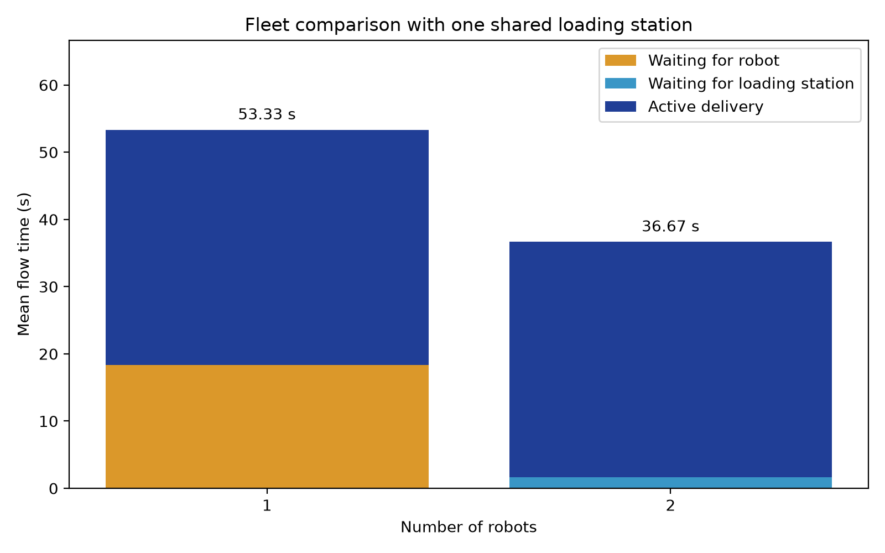

# flowops
Here I have all the works on Intelligent Material Handling System


Problem: coordinate small robots transporting containers between warehouse stations under changing demand and disruptions

Physical Environment: A 3 x 3 m2 lab area, initialized with two pickup and two delivery stations

System Decisions: Task assignment, dispatch order, shared passage access, and eventally charging

Performance Measures: On-time completion, throughput, travel time, wait time, and task failures

First Milestone: One simulated robot completes one pickup-to-delivery task and exports a timestamped event log


## Phase 1: Single-Robot Simulation

FlowOps currently models one robot performing material-handling deliveries
with loading, loaded travel, unloading, and empty return travel.

Implemented capabilities:
- Configurable travel distance, speed, and service durations.
- Sequential delivery execution.
- Independent task arrivals and a shared FIFO queue.
- Delivery duration, waiting-time, and flow-time records.
- CSV export for the sequential baseline.
- Nine automated tests covering baseline timing, selected invalid inputs,
  arrival behavior, and queue-based execution.

### Run the scenarios

Install dependencies:
    python -m pip install -r requirements.txt

Run the five-delivery baseline and generate delivery_results.csv:
    python simulation.py

Run the three-request queue scenario:
    python arrival_demo.py

Run automated tests:
    python -m unittest -v -b test_simulation

### Verified queue benchmark

Configuration: 2 m one-way distance, 0.1 m/s speed, 5 s loading,
and 10 s unloading. All times below are seconds.

| Task | Arrival | Loading start | Unloading end | Waiting | Flow time |
|------|---------|---------------|---------------|---------|-----------|
| T001 | 0       | 0             | 35            | 0       | 35        |
| T002 | 10      | 55            | 90            | 45      | 80        |
| T003 | 130     | 130           | 165           | 0       | 35        |

The robot completes its final empty return at 185 seconds.

### Modeling assumptions

- One robot starts at the pickup station at time zero.
- Travel speed and loading/unloading durations are deterministic.
- Loaded and empty travel use identical distances and speeds.
- Requests are served in arrival order; simultaneous arrivals retain
  their order in the input list.
- The robot returns to pickup after every delivery, including the last.
- Waiting time runs from request arrival to loading start.
- Flow time runs from request arrival to unloading completion.
- Traffic conflicts, station capacity, battery use, and failures are
  not yet modeled.

This is an operational discrete-event model, not yet a physics simulation.


## Fleet-size comparison

This deterministic scenario compares one and two robots serving three
requests arriving at 0, 0, and 130 seconds through one shared loading
station. Loading takes 5 seconds, unloading takes 10 seconds, and each
2-meter trip takes 20 seconds at 0.1 m/s.



| Metric | One robot | Two robots |
|---|---:|---:|
| Completed deliveries | 3 | 3 |
| Mean waiting for a robot (s) | 18.33 | 0.00 |
| Mean waiting for loading capacity (s) | 0.00 | 1.67 |
| Mean flow time (s) | 53.33 | 36.67 |
| Fleet finish time, including final return (s) | 185.00 | 185.00 |

Adding a second robot reduces mean flow time by 31.25% in this scenario.
Fleet finish time remains unchanged because the final request arrives
at 130 seconds.

Flow time runs from request arrival to unloading completion. It excludes
empty return travel. Active delivery time includes loading, loaded travel,
and unloading, but excludes waiting.

These results describe this specific scenario. The model currently excludes
traffic conflicts, battery constraints, and uncertainty.


### Reproduce the comparison

```powershell
python -m pip install -r requirements.txt
python -m unittest -v -b test_simulation
python compare_fleets.py
python plot_fleet_comparison.py
```

The comparison script writes `fleet_comparison.csv`.
The plotting script reads that CSV and writes `fleet_comparison.png`.